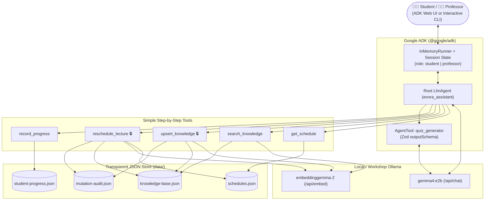

# Building an Autonomous Academic Assistant with Local LLMs: ADK, Gemma, and Dynamic RAG

> **DevFest GDG Évora 2026 — Hands-On Workshop & Runnable Repository**
>
> **Duration:** 90 Minutes &nbsp;|&nbsp; **Format:** 5-Step Live-Coding Workshop &nbsp;|&nbsp; **Level:** Intermediate (Basic JavaScript)

---

## Overview

Tired of generic chatbots that forget context or hallucinate course details? In this **90-minute, 5-step hands-on workshop**, we build a local, offline-capable **University AI Assistant** powered by **Google ADK (`@google/adk`)**, **Ollama**, **`gemma4:e2b`**, and **`embeddinggemma-2`**.

Set in the **Computer Science Department at the University of Évora (*Colégio do Espírito Santo*)**, your agent will:
1. **Run 100% locally** on `gemma4:e2b` (or connect to the temporary workshop Ollama server via `.env`).
2. **Look up lecture schedules** and **generate structured practice quizzes** (`FunctionTool` + `AgentTool` with Zod `outputSchema`).
3. **Tutor students** over course syllabi and lecture notes using dense `embeddinggemma-2` vectors.
4. **Update its own knowledge base in real time (Mutable RAG)**—rescheduling rooms, updating syllabi in-place (`version++`), blocking unauthorized student edits via ADK session state, and tracking student quiz progress!

---

## Architecture



---

## Quick Start (3 Commands!)

```bash
npm install
npm run smoke     # Verifies Ollama + gemma4:e2b + embeddinggemma-2
npm run step1     # Run Step 1 (or `npm run web` for the visual browser UI!)
npm run slides    # Open the interactive GDG Évora slide deck at http://localhost:3000
```

---

## The 5 Simple Steps (90 Minutes)

All plumbing (`src/lib/ollama.js`, `src/lib/storage.js`, and University of Évora seed data) is **already built for you** so each workshop step fits on **a single screen**:

| Step | File | Run in Terminal | Run in Browser UI | What You Build |
| :--- | :--- | :--- | :--- | :--- |
| **[00 — Setup](./docs/00-setup.md)** | `src/smoke-test.js` | `npm run smoke` | — | Pull `gemma4:e2b` & `embeddinggemma-2` (or set `OLLAMA_HOST`), verify setup |
| **[Step 1](./docs/step-1-local-inference.md)** | `src/steps/step1-agent.js` *(26 lines)* | `npm run step1` | `npm run web:step1` | First local `LlmAgent` with `gemma4:e2b` |
| **[Step 2](./docs/step-2-adk-tools-and-structured-output.md)** | `src/steps/step2-tools.js` *(70 lines)* | `npm run step2` | `npm run web:step2` | `get_schedule` `FunctionTool` + `quiz_generator` `AgentTool` (`outputSchema`) |
| **[Step 3](./docs/step-3-static-rag.md)** | `src/steps/step3-static-rag.js` *(80 lines)* | `npm run step3` | `npm run web:step3` | Vector search with `embeddinggemma-2` + **breaking Static RAG** with stale chunks |
| **[Step 4](./docs/step-4-mutable-rag.md)** | `src/steps/step4-mutable-rag.js` *(135 lines)* | `npm run step4` | `npm run web:step4` | **Mutable RAG** (`docKey` upsert, `version++`, `professor` guard, student progress) |
| **[Step 5](./docs/step-5-end-to-end-assistant.md)** | `src/steps/step5-cli.js` *(96 lines)* | `npm start` | `npm run web` | Interactive CLI assistant (`/role`, `/kb`, `/progress`, `/audit`) |

### Extra Guides & Slides
- **[Interactive Workshop Slides (`slides/index.html`)](./slides/index.html):** 15-slide Google GDG Évora presentation deck with click-to-copy commands, speaker notes (`S`), and fullscreen mode (`F`). Run `npm run slides` or open directly in your browser.
- **[06 — Enterprise Architecture Playbook](./docs/06-architecture-and-enterprise-playbook.md):** Scaling to customer support, internal knowledge hubs, `RoutedLlm`, and `pgvector`.
- **[Instructor & Facilitator Guide](./INSTRUCTOR_GUIDE.md):** Minute-by-minute 90-minute run-of-show, slide talking points, and shared workshop `OLLAMA_HOST` server setup.

---

## Repository Structure

```text
.
├── .env.example                 # OLLAMA_HOST, gemma4:e2b & embeddinggemma-2 config
├── package.json                 # npm scripts for all 5 steps + ADK Web UI + slides
├── slides/
│   └── index.html               # 📊 Interactive 15-slide GDG Évora presentation deck
├── data/                        # Auto-created JSON stores (inspect live in your editor!)
├── src/
│   ├── smoke-test.js            # Pre-flight check for Ollama chat + embeddings
│   ├── seed.js                  # Resets data/ back to clean University of Évora state
│   ├── agent.js                 # Default entry point for `npm run web`
│   ├── lib/                     # Pre-built helpers (zero boilerplate during the workshop!)
│   │   ├── ollama.js            # Custom ADK BaseLlm for Ollama + embeddinggemma-2 client
│   │   ├── seed-data.js         # Évora CS courses, rooms (Colégio do Espírito Santo) & notes
│   │   ├── storage.js           # Tiny JSON read/write helpers for data/
│   │   └── runner.js            # 1-line demo runner for Steps 1–4
│   └── steps/                   # ⭐ THE 5 WORKSHOP STEPS ⭐
│       ├── step1-agent.js
│       ├── step2-tools.js
│       ├── step3-static-rag.js
│       ├── step4-mutable-rag.js
│       └── step5-cli.js
└── docs/                        # Step-by-step workshop guides
```
