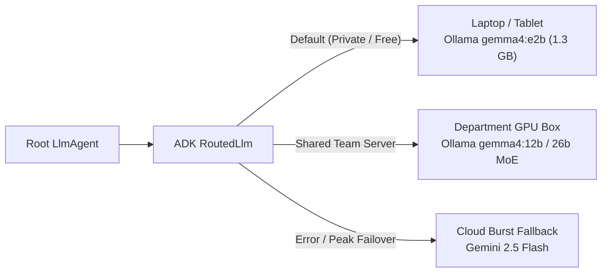

# 06 — Beyond the Classroom: Enterprise Architecture & Production Playbook

[← Step 5: End-to-End Assistant CLI](./step-5-end-to-end-assistant.md) &nbsp;|&nbsp; [🏠 Workshop Home](../README.md) &nbsp;|&nbsp; [📋 Instructor Guide](../INSTRUCTOR_GUIDE.md)

> **Take-Home Architecture Reference**
>
> How to extrapolate the patterns you built today—**local Gemma inference**, **ADK tool orchestration**, **structured `AgentTool` schemas**, and **role-gated Mutable RAG**—into production business and enterprise systems.

---

## 1. Domain Extrapolation Matrix

Every primitive in your `evora-academic-assistant` repository maps 1-to-1 onto high-value enterprise agent workflows where **data privacy**, **zero per-token API bills**, and **rapidly changing ground truth** matter:

| Workshop Component | 🎧 Customer Support Triage | 🏢 Internal Enterprise Knowledge Hub | ⚙️ Field Service & Ops Automation |
| :--- | :--- | :--- | :--- |
| **`OllamaLlm` (`gemma4`)** | On-prem PII-safe ticket handling (GDPR/HIPAA compliant) | Air-gapped engineering/legal Q&A inside corporate VPC | Offline-capable tablet assistant on factory floors or wind farms |
| **`get_lecture_schedule`** | `get_order_status` / `get_sla_window` | `get_oncall_rotation` / `get_service_owner` | `get_maintenance_shift` / `get_part_inventory` |
| **`quiz_generator_agent` (`outputSchema`)** | Structured ticket classification & escalation payload (`severity`, `team`, `summary`) | Structured compliance checklist or RFC review rubric | Structured safety inspection form (`pass/fail` JSON) |
| **Mutable RAG (`upsertDocument`)** | Live product pricing, outage status, or return-policy updates replacing stale docs | Updating runbooks & API deprecations in-place (`runbook:auth-v3`) | Real-time equipment calibration notes superseding old specs |
| **`student-progress.json`** | Customer onboarding checklist & resolved-issue history | Employee onboarding & security-training completion | Technician certification & completed work-order log |
| **`Context.state` Role Guard + Audit Log** | `customer` vs. `support_lead` + SOC2 change log | `employee` vs. `doc_maintainer` + Git/DB audit log | `technician` vs. `plant_supervisor` + ISO audit trail |

---

## 2. Scaling the Inference Tier (`gemma4:e2b` → Hybrid `RoutedLlm`)

Because your agent depends on `@google/adk`'s **`BaseLlm`** abstraction rather than hardcoding vendor SDK calls inside your tools, scaling model capacity requires **zero changes to your tools or RAG code**:



### Example: Automatic Local-to-Cloud Failover with ADK's Built-In `RoutedLlm`

`@google/adk` ships with `RoutedLlm` out of the box—allowing you to run **99% of traffic locally on Ollama** while failing over automatically if the local GPU box restarts:

```javascript
import { RoutedLlm, Gemini } from '@google/adk';
import { OllamaLlm } from './lib/ollama.js';

export const resilientModel = new RoutedLlm({
  models: {
    local_gemma: new OllamaLlm({ model: 'gemma4:e4b' }),
    cloud_fallback: new Gemini({ model: 'gemini-2.5-flash' }),
  },
  router: (_models, _request, errorContext) => {
    if (!errorContext) return 'local_gemma';
    if (errorContext.failedKeys.has('local_gemma')) return 'cloud_fallback';
    return undefined;
  },
});
```

### Choosing the Right Gemma 4 Size

| Model Tag | Approx. VRAM / RAM | Best Use Case |
| :--- | :---: | :--- |
| **`gemma4:e2b`** | ~1.3 GB | Workshops, mobile/edge devices, 8 GB laptops, fast single/dual-tool agents |
| **`gemma4:e4b`** | ~2.3 GB | Sweet spot for developer laptops & complex 5–10 tool schemas |
| **`gemma4:12b`** | ~8 GB | Departmental server handling nuanced multi-document synthesis |
| **`gemma4:26b`** | ~16 GB (MoE) | High-throughput internal enterprise hub with near-frontier reasoning |

---

## 3. Scaling Mutable RAG Beyond Local JSON

Our pure-JS `data/knowledge-base.json` store comfortably handles **1,000–5,000 chunks** in memory (<20 ms cosine scan in V8!). When scaling to **100,000+ chunks** or **concurrent multi-user writes**, keep the **exact same 4 Mutable RAG invariants** while swapping the storage backend:

1. **Preserve Deterministic `docKey` Primary/Unique Keys:**
   - **PostgreSQL + `pgvector`:**
     ```sql
     CREATE TABLE knowledge_chunks (
       doc_key TEXT PRIMARY KEY,
       course_code TEXT NOT NULL,
       category TEXT NOT NULL,
       title TEXT NOT NULL,
       content TEXT NOT NULL,
       version INT NOT NULL DEFAULT 1,
       updated_by TEXT NOT NULL,
       updated_at TIMESTAMPTZ NOT NULL DEFAULT NOW(),
       embedding VECTOR(768) NOT NULL
     );
     ```
   - A Mutable RAG update becomes a single transactional `INSERT ... ON CONFLICT (doc_key) DO UPDATE SET content = EXCLUDED.content, embedding = EXCLUDED.embedding, version = knowledge_chunks.version + 1`!
2. **Use Optimistic Concurrency Control (`expectedVersion`):**
   - If two professors edit `CC301:grading` simultaneously, check `WHERE doc_key = $1 AND version = $2` so neither silently overwrites the other's edit.
3. **Chunk-Set Replacement for Long Documents:**
   - When a 20-page PDF syllabus is split into multiple chunks (`CC301:syllabus#0`, `CC301:syllabus#1`, ...), wrap `DELETE FROM knowledge_chunks WHERE parent_key = 'CC301:syllabus'` + batch `INSERT` of the new chunks inside a **single database transaction** so orphan tail chunks never survive when a document shrinks!
4. **Transactional Sync (Outbox Pattern):**
   - Just like `reschedule_lecture` updated both `schedules.json` and `CC301:schedule` together, update your relational row and your vector embedding in the same transaction (or CDC queue) to prevent structured-vs-semantic drift.

---

## 4. Production Hardening Features Built Into `@google/adk`

When turning your workshop prototype into a deployed service, explore these three native `@google/adk` capabilities already installed in your `node_modules`:

- **Human-in-the-Loop Confirmation (`requireConfirmation`):**
  Add `requireConfirmation: true` (or a predicate `(args, ctx) => ...`) directly on destructive `FunctionTool`s (`delete_course_knowledge` or `reschedule_lecture`). ADK automatically pauses tool execution and emits a confirmation request event before mutating data!
- **Persistent Multi-User Sessions (`DatabaseSessionService`):**
  Swap `InMemoryRunner` for `Runner` + `DatabaseSessionService` (`@google/adk/sessions/database`) backed by SQLite or PostgreSQL so user conversations and roles survive server restarts.
- **Automated Agent Evals (`adk eval`):**
  Use `@google/adk-devtools` evaluation suites to assert tool trajectories (`TOOL_TRAJECTORY_SCORE_KEY`) in CI whenever you upgrade prompts or swap between `gemma4:e2b` and `gemma4:e4b`.

---

[← Step 5: End-to-End Assistant CLI](./step-5-end-to-end-assistant.md) &nbsp;|&nbsp; [🏠 Workshop Home](../README.md) &nbsp;|&nbsp; [📋 Instructor Guide](../INSTRUCTOR_GUIDE.md)
