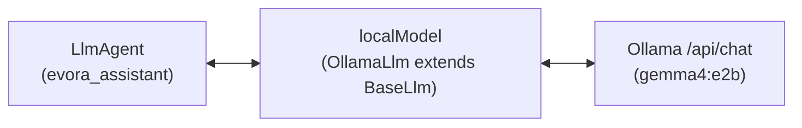

# Step 1 — Your First Local Agent with Ollama & Google ADK

[← 00: Setup](./00-setup.md) &nbsp;|&nbsp; [🏠 Workshop Home](../README.md) &nbsp;|&nbsp; [Next: Step 2 — Tools & Quizzes →](./step-2-adk-tools-and-structured-output.md)

> **Duration:** 15 Minutes &nbsp;|&nbsp; **File:** `src/steps/step1-agent.js` *(26 lines)*
>
> **Goal:** Connect your local `gemma4:e2b` model to Google ADK's `LlmAgent` and see both what it can do—and why a bare LLM fails on live university facts.

---

## 1. How Google ADK Talks to Local Ollama

Google ADK (`@google/adk`) separates **agent logic** (`LlmAgent`) from **model backends** (`BaseLlm`). In `src/lib/ollama.js`, `localModel` extends `BaseLlm` to forward prompts, tool schemas, and JSON schemas directly to your local Ollama `/api/chat` endpoint (`gemma4:e2b`).



---

## 2. The Code (`src/steps/step1-agent.js`)

Open `src/steps/step1-agent.js`—the entire agent takes **10 lines**:

```javascript
import { LlmAgent } from '@google/adk';
import { localModel } from '../lib/ollama.js';
import { isMain, askAgent } from '../lib/runner.js';

// Step 1: Connect local Ollama (`gemma4:e2b`) to a Google ADK LlmAgent
export const rootAgent = new LlmAgent({
  name: 'evora_assistant',
  description: 'Local University of Évora CS Assistant powered by Gemma 4.',
  model: localModel,
  instruction: `
You are the Computer Science AI Assistant at the University of Évora.
Be concise and friendly.
If you do not know specific room numbers or grading rules, say so clearly instead of guessing.
  `.trim(),
});

if (isMain(import.meta.url)) {
  await askAgent(
    rootAgent,
    'Explain the difference between a process and a thread in 2 sentences.'
  );
  await askAgent(
    rootAgent,
    'What room is CC301 Distributed Systems in at Colégio do Espírito Santo?'
  );
}
```

---

## 3. Run & Verify Step 1

### Run in Terminal
```bash
npm run step1
```

- **Prompt 1 (General CS concept):** `gemma4:e2b` explains processes vs. threads cleanly offline!
- **Prompt 2 (Évora room number):** Because the model has **no tools** yet, it admits it doesn't have access to University of Évora schedules (instead of hallucinating a room!).

### Or Inspect Visually in ADK Web UI!
```bash
npm run web:step1
```
Open **[http://localhost:8000](http://localhost:8000)** to chat with `evora_assistant` in the browser and inspect ADK's event trace!

---

[← 00: Setup](./00-setup.md) &nbsp;|&nbsp; [🏠 Workshop Home](../README.md) &nbsp;|&nbsp; [Next: Step 2 — Tools & Quizzes →](./step-2-adk-tools-and-structured-output.md)
