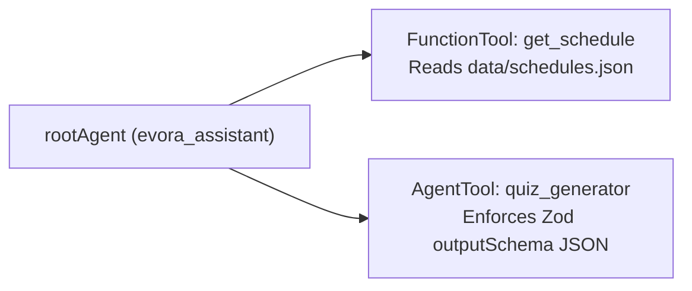

# Step 2 — Agent Tools & Structured Practice Quizzes

[← Step 1: First Local Agent](./step-1-local-inference.md) &nbsp;|&nbsp; [🏠 Workshop Home](../README.md) &nbsp;|&nbsp; [Next: Step 3 — Static RAG →](./step-3-static-rag.md)

> **Duration:** 20 Minutes &nbsp;|&nbsp; **File:** `src/steps/step2-tools.js` *(70 lines)*
>
> **Goal:** Give your local `gemma4:e2b` agent two superpowers:
> 1. **`FunctionTool` (`get_schedule`):** Looks up verified University of Évora lecture rooms and times.
> 2. **`AgentTool` (`quiz_generator`):** Uses a Zod `outputSchema` to return **100% valid JSON** practice quizzes without breaking conversational chat.

---

## 1. Two Types of Tools in Google ADK



> [!IMPORTANT]
> **Why wrap `outputSchema` in an `AgentTool`?**
> Putting `outputSchema` directly on `rootAgent` forces *every* chatbot message into raw JSON. Wrapping a specialist `quizAgent` inside `new AgentTool({ agent: quizAgent })` keeps `rootAgent` conversational while guaranteeing every quiz has valid `question`, `options`, `correctIndex`, and `explanation` fields!

---

## 2. The Code (`src/steps/step2-tools.js`)

Open `src/steps/step2-tools.js`:

```javascript
import { LlmAgent, FunctionTool, AgentTool } from '@google/adk';
import { z } from 'zod';
import { localModel, createLocalModel } from '../lib/ollama.js';
import { getSchedules } from '../lib/storage.js';
import { isMain, askAgent } from '../lib/runner.js';

// 1. FunctionTool: Deterministic lecture schedule lookup with Zod validation
export const getScheduleTool = new FunctionTool({
  name: 'get_schedule',
  description: 'Looks up University of Évora CS lecture rooms, days, times, and office hours.',
  parameters: z.object({
    courseCode: z.string().optional().describe('Course code like CC301, CC304, or CC208'),
    day: z.string().optional().describe('Weekday like Monday, Tuesday, or Thursday'),
  }),
  execute: async ({ courseCode, day }) => {
    const schedules = await getSchedules();
    return schedules.filter((s) => {
      const matchCode = !courseCode || s.courseCode.toLowerCase() === courseCode.toLowerCase();
      const matchDay = !day || s.day.toLowerCase() === day.toLowerCase();
      return matchCode && matchDay;
    });
  },
});

// 2. AgentTool: Specialist quiz sub-agent with strict Zod `outputSchema`
const quizAgent = new LlmAgent({
  name: 'quiz_generator',
  description: 'Generates a structured 2-question multiple-choice practice quiz for a CS topic.',
  model: createLocalModel({ temperature: 0.4 }),
  includeContents: 'none',
  inputSchema: z.object({
    courseCode: z.string().describe('Course code, e.g. CC301'),
    topic: z.string().describe('Topic to quiz the student on'),
  }),
  outputSchema: z.object({
    courseCode: z.string(),
    topic: z.string(),
    questions: z.array(
      z.object({
        question: z.string(),
        options: z.array(z.string()),
        correctIndex: z.number().int(),
        explanation: z.string(),
      })
    ),
  }),
  instruction:
    'Create 2 clear multiple-choice questions (4 options each) for the requested CS topic. Return valid JSON matching the output schema.',
});

export const quizTool = new AgentTool({ agent: quizAgent });

// 3. Root Agent combining FunctionTool + AgentTool
export const rootAgent = new LlmAgent({
  name: 'evora_assistant',
  model: localModel,
  instruction: `
You are the University of Évora CS Assistant.
- Always call 'get_schedule' for lecture times, rooms, or office hours.
- Always call 'quiz_generator' when asked for a practice quiz or exercise.
  `.trim(),
  tools: [getScheduleTool, quizTool],
});

if (isMain(import.meta.url)) {
  await askAgent(rootAgent, 'Where and when does CC301 Distributed Systems meet?');
  await askAgent(rootAgent, 'Give me a practice quiz for CC208 on Dijkstra shortest paths.');
}
```

---

## 3. Run & Verify Step 2

### Run in Terminal
```bash
npm run step2
```
Watch the live `🔧 tool ->` logs appear as `gemma4:e2b` calls `get_schedule({"courseCode":"CC301"})` (**Tuesday 10:00-12:00, CES-131**) and `quiz_generator`!

### Or Inspect in ADK Web UI
```bash
npm run web:step2
```
Click the `quiz_generator` event in the left trace panel of **[http://localhost:8000](http://localhost:8000)** to see the validated JSON quiz payload!

---

[← Step 1: First Local Agent](./step-1-local-inference.md) &nbsp;|&nbsp; [🏠 Workshop Home](../README.md) &nbsp;|&nbsp; [Next: Step 3 — Static RAG →](./step-3-static-rag.md)
