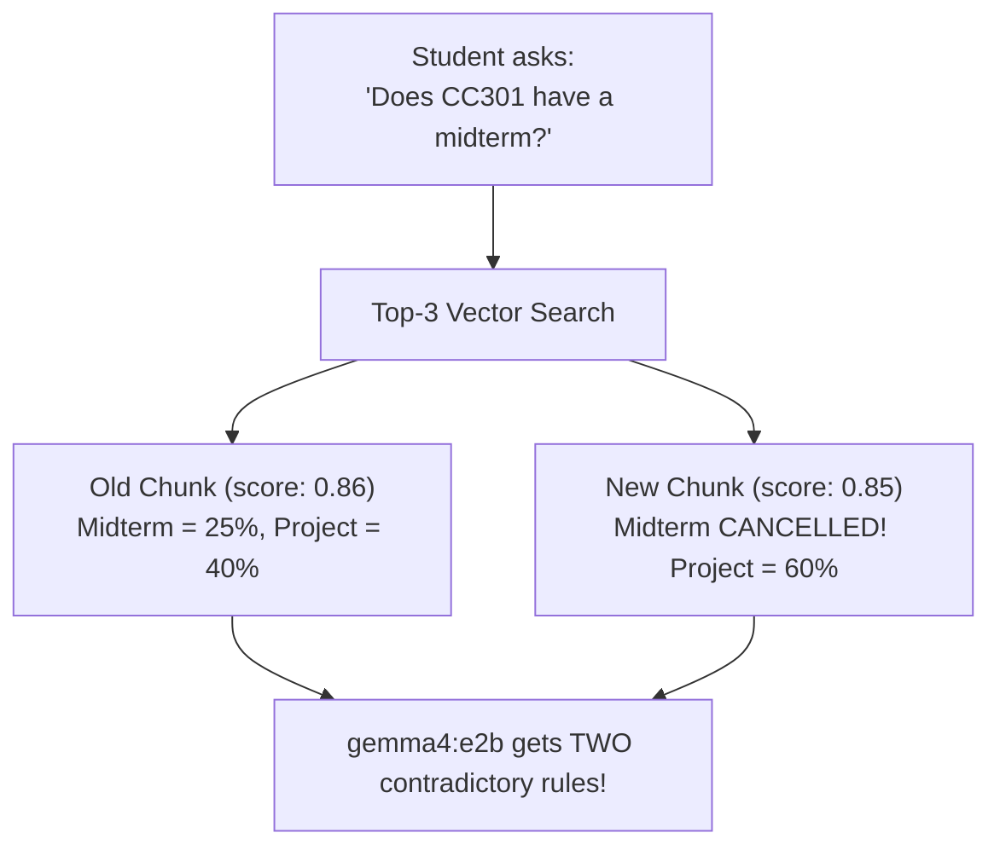

# Step 3 — Static RAG & Why It Breaks When Facts Change

[← Step 2: Tools & Quizzes](./step-2-adk-tools-and-structured-output.md) &nbsp;|&nbsp; [🏠 Workshop Home](../README.md) &nbsp;|&nbsp; [Next: Step 4 — Mutable RAG →](./step-4-mutable-rag.md)

> **Duration:** 15 Minutes &nbsp;|&nbsp; **File:** `src/steps/step3-static-rag.js` *(80 lines)*
>
> **Goal:** Add vector search over University of Évora syllabi using **`embeddinggemma-2`**, then **watch Static RAG break** when a grading policy changes!

---

## 1. The Append-Only Trap in Standard RAG

Most RAG tutorials only **append** new chunks (`kb.documents.push(...)`). Look what happens the moment a professor cancels a midterm exam:



---

## 2. The Code (`src/steps/step3-static-rag.js`)

Notice how we reuse `getScheduleTool` and `quizTool` from Step 2 so we only write the **2 RAG tools**:

```javascript
import crypto from 'node:crypto';
import { LlmAgent, FunctionTool } from '@google/adk';
import { z } from 'zod';
import { localModel, embedText, cosineSimilarity } from '../lib/ollama.js';
import { getKnowledgeBase, saveKnowledgeBase, seedAll } from '../lib/storage.js';
import { isMain, askAgent } from '../lib/runner.js';
import { getScheduleTool, quizTool } from './step2-tools.js';

// 1. Semantic vector search over `data/knowledge-base.json` using `embeddinggemma-2`
export const searchKnowledgeTool = new FunctionTool({
  name: 'search_knowledge',
  description: 'Searches Évora CS syllabi, grading rules, and lecture notes via vector similarity.',
  parameters: z.object({
    query: z.string().describe('Search query, e.g. "CC301 grading" or "Raft election"'),
    courseCode: z.string().optional().describe('Optional filter: CC301, CC304, or CC208'),
  }),
  execute: async ({ query, courseCode }) => {
    const kb = await getKnowledgeBase();
    const queryVec = await embedText(query);

    return kb.documents
      .filter((d) => !courseCode || d.courseCode.toLowerCase() === courseCode.toLowerCase())
      .map((d) => ({
        docKey: d.docKey,
        title: d.title,
        content: d.content,
        version: d.version,
        score: Number(cosineSimilarity(queryVec, d.embedding).toFixed(4)),
      }))
      .sort((a, b) => b.score - a.score)
      .slice(0, 3);
  },
});

// 2. NAIVE Static RAG update: appends a new chunk without replacing the outdated one!
const appendNoteNaiveTool = new FunctionTool({
  name: 'append_course_note',
  description: 'Appends a new course announcement to the knowledge base (static append-only).',
  parameters: z.object({
    courseCode: z.string().describe('Course code, e.g. CC301'),
    title: z.string().describe('Announcement title'),
    content: z.string().describe('Full announcement text'),
  }),
  execute: async ({ courseCode, title, content }) => {
    const kb = await getKnowledgeBase();
    const embedding = await embedText(`[${courseCode}] ${title}\n${content}`);
    kb.documents.push({
      id: crypto.randomUUID(),
      courseCode: courseCode.toUpperCase(),
      title,
      content,
      version: 1,
      embedding,
    });
    await saveKnowledgeBase(kb);
    return { status: 'appended', totalDocs: kb.documents.length };
  },
});

export const rootAgent = new LlmAgent({
  name: 'evora_assistant',
  model: localModel,
  instruction: `
You are the University of Évora CS Assistant.
- Use 'get_schedule' for lecture times and rooms.
- Use 'search_knowledge' for grading rules and lecture concepts. Base answers strictly on the results.
- Use 'append_course_note' when asked to post a new course announcement.
- Use 'quiz_generator' when asked for practice exercises.
  `.trim(),
  tools: [getScheduleTool, searchKnowledgeTool, appendNoteNaiveTool, quizTool],
});

if (isMain(import.meta.url)) {
  await seedAll();
  await askAgent(rootAgent, 'How is CC301 Distributed Systems graded?');
  await askAgent(
    rootAgent,
    'Post a new announcement for CC301 titled "Updated CC301 Grading": Midterm is cancelled! Project is now 60% and Final Exam is 40%.'
  );
  console.log('\n⚠️  Now watch a new student query hit BOTH conflicting chunks in data/knowledge-base.json:');
  await askAgent(rootAgent, 'Does CC301 have a midterm exam, and what are the grading weights?');
}
```

---

## 3. Run & Inspect the Bug!

```bash
npm run step3
```

Open **`data/knowledge-base.json`** in your editor right after running `npm run step3`:
1. Scroll to the top: `CC301:grading` still says **`Midterm Exam = 25%`**.
2. Scroll to the bottom: a second chunk says **`Midterm is cancelled!`**.
3. Even worse: **any student** could run that prompt and poison the knowledge base!

Let's fix all of that cleanly in **Step 4 — Mutable RAG**!

---

[← Step 2: Tools & Quizzes](./step-2-adk-tools-and-structured-output.md) &nbsp;|&nbsp; [🏠 Workshop Home](../README.md) &nbsp;|&nbsp; [Next: Step 4 — Mutable RAG →](./step-4-mutable-rag.md)
